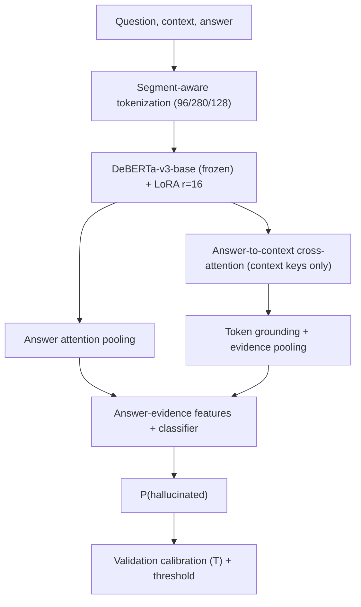

# Architecture

## Runtime flow

1. Load one condition or ablation YAML and merge it with `configs/base.yaml`.
2. Resolve every path from the project root, not the notebook directory.
3. Validate required fields, class balance, expected row counts, hashes, and
   question/context group disjointness across train, validation and evaluation.
4. Normalize the three fixed splits without resampling. Context is selected
   per answer: up to eight sentences and about 280 tokens, scored by question
   similarity (0.45), answer similarity (0.45) and entity overlap (0.10).
5. Build or reuse a content-addressed tokenization cache.
6. Train the detector (AdamW, cosine decay with 10% warmup, at most 5 epochs,
   patience 2) and select the best checkpoint using validation F1.
7. Reload the best checkpoint and fit the temperature `T` (minimises validation
   cross-entropy) and the threshold `τ` (swept 0.05–0.95, step 0.01, maximising
   hallucinated-class F1) on validation only.
8. Evaluate the frozen test set and write aligned predictions. Test labels
   never influence `T` or `τ`.

Each heavy training/evaluation stage runs in a fresh Python process so GPU
memory is released between ablation variants.

## Detector computation

The input is `[CLS] question [SEP] context [SEP] answer [SEP]` with budgets of
96 / ~280 / 128 tokens (question / context / answer) inside 512 tokens. Long
answers keep both their beginning and end. Boolean masks mark the question,
context, answer and padding spans.

- **Encoder.** `microsoft/deberta-v3-base` (hidden size 768) stays frozen. LoRA
  (rank 16, alpha 32, dropout 0.05) is applied to the query, key, value and
  attention-output projections.
- **Answer representation.** Learned attention pooling over answer tokens,
  fused with the pooled `[CLS]` state.
- **Evidence.** 8-head cross-attention where only context positions are keys
  and values, with no residual connection, so each evidence state describes only
  what the context says near that answer token. A reverse context-to-answer
  branch is instantiated but not used by the classifier.
- **Grounding and pooling.** Each answer token gets a grounding score from its
  own state and its evidence state. The evidence vector is the grounding-weighted
  average of the evidence states (grounding temperature 1.0).
- **Classifier.** Input features are the answer vector, the evidence vector,
  their absolute difference, their elementwise product and their cosine (3,073
  dimensions), plus six grounding statistics, 3,079 in total. The MLP is
  3079 → 1024 → 512 → 128 → 1 with GELU, LayerNorm after the first two hidden
  layers and dropout 0.20 / 0.15 / 0.10.
- **Size.** About 11.0M trainable parameters. The backbone contributes none.

The legacy HKG-Fusion implementation remains in `models/legacy_hkg.py` only
for comparison and loading old checkpoints.

## Ablation variants

B–F all use a joint question/context/answer encoder, and the full-width feature
layout is preserved across variants, with disabled features zeroed.

| Variant | Adds |
|---|---|
| B | Attention-pooled answer representation; evidence features zeroed (context stays in the encoder input) |
| C | Answer-to-context cross-attention with uniform evidence pooling |
| D | Learned token-grounding weights for evidence pooling |
| E | Six grounding/pooling statistics in the classifier |
| F | Difference, product and cosine interactions (the full detector) |

In the paper's three-seed results, the evidence pathway (F vs B) improves AUROC
(+0.39) and MCC (+0.72) but F1 only by +0.24. Rung E lowers F1 by 1.69 and is
the one block the paper recommends omitting.

## Numerical notes

Grounding logits, pooling weights, statistics and evidence accumulation are
computed in FP32 before converting pooled evidence back to the encoder dtype.
This prevents FP16 epsilon underflow and infinite gradients for single-token or
empty answer spans. Frozen evaluation applies the saved validation temperature
to raw scalar logits, matching validation calibration without recovering logits
from clipped probabilities. Parameter names remain compatible; precision changes
can affect predictions and should be recorded when comparing against older runs.
